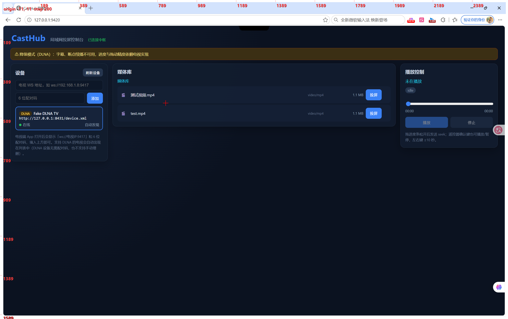

# CastHub

<p align="center">
  <strong>局域网投屏，把 PC 上的本地视频直接送上电视。</strong><br />
  开源 · 免云上传 · Windows 桌面端 / Android TV / DLNA
</p>

<p align="center">
  <a href="https://github.com/subeichen1/casthub/actions/workflows/ci.yml"></a>
  <a href="https://github.com/subeichen1/casthub/releases/latest"></a>
  <a href="LICENSE"></a>
  
  
</p>

CastHub 是一个开源的局域网投屏工具，由 **PC 中枢、浏览器控制台和 Android TV 客户端** 三部分组成。它可以把电脑上的本地视频直接投到电视播放，不需要数据线，不需要 U 盘，也不会上传云端。对于不能安装 App 的电视，CastHub 还提供 DLNA/UPnP 降级模式，尽可能覆盖更多家庭设备。

**English** — CastHub is an open-source, self-hosted LAN casting tool that streams local videos from your PC to Android TV and DLNA-enabled TVs. No cables, USB drives, or cloud uploads required.


> 当前版本：**v0.2.1**。主线投屏链路已通过自动化端到端测试；DLNA 是兼容性降级路径，具体限制见 [DLNA 兼容模式](#dlna-兼容模式降级)。

## 核心特性

| 能力 | 说明 |
| --- | --- |
| **本地投屏** | 浏览器控制台浏览媒体库，一键把视频投到电视；支持播放、暂停、拖动进度和停止。 |
| **DLNA 兼容** | 电视装不了 App 时，自动发现并驱动电视自带的 DLNA/UPnP 播放器。 |
| **播放历史** | 按文件路径保存播放位置；再次投同一文件默认续播，可从控制台管理历史。 |
| **Windows 桌面端** | 免安装 portable 版，双击即用，可放 U 盘携带；支持同目录 `config.json`。 |
| **Android TV 客户端** | Kotlin + Media3/ExoPlayer 原生播放，支持遥控器操作与 8 位安全配对码。 |
| **局域网直连** | PC 与电视直接传输媒体流，不经过云端；支持 HTTP Range，进度拖动可靠。 |
| **零构建控制台** | 原生 HTML/CSS/JavaScript，无需前端构建工具，打开浏览器即可使用。 |

## 系统要求

| 组件 | 要求 |
| --- | --- |
| PC 中枢（桌面版） | Windows 10 / 11，无需安装 Node.js |
| PC 中枢（源码 / 部署脚本） | Node.js 22+、npm，Windows / macOS / Linux |
| Android TV 客户端 | Android 6.0（API 23）及以上，约 8 MB 存储空间 |
| 网络 | PC 与电视连接同一局域网，路由器未开启 AP 隔离 |

## 快速开始

### 方式一：Windows 一键安装（推荐）

在 PowerShell 中运行：

```powershell
$p = Join-Path $env:TEMP 'CastHub-install.ps1'; iwr -UseBasicParsing https://github.com/subeichen1/casthub/releases/latest/download/install.ps1 -OutFile $p; powershell -NoProfile -ExecutionPolicy Bypass -File $p
```

安装脚本会自动完成以下步骤：

1. 从最新 Release 下载 `CastHub.exe`，并校验 SHA-256（可用 `-Sha256` 指定官方值，或用 `-RequireSignature` 强制要求 Authenticode 签名）；
2. 安装到 `%LOCALAPPDATA%\CastHub`；
3. 创建桌面和开始菜单快捷方式；
4. 创建默认媒体目录 `%USERPROFILE%\Videos\CastHub`；
5. 启动 CastHub 桌面端。

安装完成后，把视频放入默认媒体目录，或在程序目录的 `config.json` 中修改 `mediaDir`。脚本源码见 [scripts/install.ps1](scripts/install.ps1)。

### 方式二：源码一键启动（Windows / macOS / Linux）

需要预先安装 **Node.js 22+** 和 Git。将下面整段命令粘贴到终端：

```bash
git clone --depth 1 https://github.com/subeichen1/casthub.git && cd casthub/server && npm install && npm start
```

启动成功后打开 `http://<PC 局域网 IP>:9420`。默认媒体目录为 `server/media`，可通过 `MEDIA_DIR` 环境变量指定其他目录。

### 方式三：Linux / macOS 一键部署脚本

```bash
curl -fsSL https://github.com/subeichen1/casthub/releases/latest/download/install.sh | bash
```

脚本会从最新 Release 下载源码包，并用 `checksums.txt` 校验 SHA-256（也可用 `CASTHUB_SHA256` 指定），然后部署到 `~/.local/share/casthub`、安装依赖并编译服务端，默认安装完成后直接启动；也可稍后手动执行 `~/.local/share/casthub/start-casthub.sh`。可通过环境变量 `CASTHUB_DIR`、`CASTHUB_MEDIA_DIR`、`CASTHUB_PORT` 覆盖默认路径和端口。

### 方式四：下载 Android TV 客户端

从 [Releases](https://github.com/subeichen1/casthub/releases/latest) 下载已签名的 `CastHub-TV.apk`，并用 `checksums.txt` 核对 SHA-256 后通过 U 盘安装到电视。详细步骤见 [电视端 App 安装](#电视端-app-安装tcl-u-盘-sideload)。

### 方式五：自动化 / 无人值守（非 AI 功能）

这里的“AI Agent”只是指自动化安装场景，项目本身不包含 AI/ML 功能。CI 或无图形环境建议使用“只安装、不启动、不创建快捷方式”的模式：

**Windows（PowerShell）**

```powershell
$p = Join-Path $env:TEMP 'CastHub-install.ps1'; iwr -UseBasicParsing https://github.com/subeichen1/casthub/releases/latest/download/install.ps1 -OutFile $p; powershell -NoProfile -ExecutionPolicy Bypass -File $p -NoShortcuts -NoLaunch
```

默认安装到 `%LOCALAPPDATA%\CastHub`；需要指定路径时，在末尾追加 `-InstallDir "D:\Apps\CastHub" -MediaDir "D:\Videos\CastHub"`。需要启动时执行：

```powershell
Start-Process "$env:LOCALAPPDATA\CastHub\CastHub.exe" -WorkingDirectory "$env:LOCALAPPDATA\CastHub"
```

**Linux / macOS**

```bash
curl -fsSL https://github.com/subeichen1/casthub/releases/latest/download/install.sh | CASTHUB_NO_LAUNCH=1 bash
```

默认安装到 `~/.local/share/casthub`；把 `CASTHUB_NO_LAUNCH=1` 换成 `CASTHUB_DAEMON=1` 可在安装后后台启动，日志写入 `~/.local/share/casthub/casthub.log`。自定义路径时，在命令前加 `CASTHUB_DIR=/opt/casthub CASTHUB_MEDIA_DIR=/srv/videos`。

## 控制台界面

控制台包含四个主要区域：

- **设备**：输入电视显示的 `ws://<电视 IP>:9417` 和 8 位配对码，添加并查看设备在线状态；
- **播放历史**：列出文件名、更新时间与进度百分比，可继续播放、从头播放、删除单条或清空全部；
- **媒体库**：浏览 `MEDIA_DIR` 下的视频文件，显示文件名、类型与大小；有播放历史的文件默认从上次位置继续，并提供「从头」入口；
- **播放控制**：显示当前播放状态、进度条、暂停/继续和停止按钮。

## 播放历史与断点续播

CastHub 会按文件绝对路径记录播放位置，App（casthub）与 DLNA 设备共用同一份历史。再次投同一文件时默认从上次位置继续，也可以在控制台选择「从头播放」。

### 数据位置

优先级：`DATA_DIR` > `PORTABLE_EXECUTABLE_DIR`（桌面版 exe 所在目录）> 项目根目录。数据库固定位于其下的 `data/`：

- SQLite 模式：`data/casthub.db`
- JSON 降级模式：`data/casthub-history.json`（仅当 better-sqlite3 无法安装/加载时）
- `data/` 已加入 `.gitignore`，不与源码混在一起。

### 断点判定规则

- 每 5 秒最多落盘一次；状态切换为 paused / idle / error 时立即落盘。
- 5 秒 ≤ 播放位置 < 95% × 时长才视为有效断点；小于 5 秒不记录。
- 播放位置达到 95% 视为看完：位置清零、播放次数 +1，历史行保留。
- 时长为 0 时不判看完，避免除零。
- 续播目标超过换片源后的实际时长时，由播放错误自动清除该文件历史。

### 控制台操作

- 左侧「播放历史」列出文件名、更新时间与进度百分比，可「继续播放」「从头播放」「删除」，或点「清空」删除全部。
- 媒体库中有历史的文件，主按钮显示「继续播放」并默认 `resume=true`；旁边的「从头」按钮使用 `resume=false`。

### 备份方法

直接复制整个 `data/` 目录即可（SQLite 模式可能同时包含 `-wal`/`-shm` 临时文件；停止 CastHub 后复制最稳妥）。恢复时把 `data/` 放回同一优先级路径即可。

### JSON 降级模式

`better-sqlite3` 是可选原生依赖；如果当前机器没有预编译产物且缺少 C++ 构建工具，安装或加载失败时，中枢会记录日志并自动使用 `data/casthub-history.json`（整表读写）。接口、协议与控制台功能完全一致；在依赖安装正常的人类机器上会自然回到 SQLite。项目只保留 SQLite 与 JSON 两种实现。

### Electron 打包

`better-sqlite3` 13 起改用 N-API 并提供随包预编译二进制，通常无需单独按 Electron ABI 重建；`npm run dist` 会完成打包。若替换为自行编译的原生版本，可执行：

```bash
npx electron-builder install-app-deps
```

## 工作原理

PC 中枢基于 Node.js 22 + TypeScript + Fastify + ws，在 `9420` 端口同时提供 REST（`/api/files`）、媒体流（`/media/*`，支持 Range）与控制台 WebSocket（`/console`）。电视端 App 使用 Kotlin + Media3（ExoPlayer），自身在 `9417` 端口启动 WebSocket 服务端，中枢作为客户端主动连接电视；两条 WS 通道彼此独立。

```text
浏览器控制台 ──WS /console──▶ PC 中枢(9420) ──WS 客户端──▶ 电视 App(9417)
                                   │
                                   └──HTTP /media（Range）──▶ 电视 ExoPlayer
```

控制台通过 `/console` 让中枢下发播放指令，电视播放器通过 HTTP 直接拉取 `http://<中枢 IP>:9420/media/...`。拖动进度依赖中枢对 HTTP Range 的支持。

## 项目结构

```text
casthub/
├── server/                  # Node.js 中枢
│   ├── src/index.ts         # 入口：读取 MEDIA_DIR / PUBLIC_BASE_URL / config.json
│   ├── src/files.ts         # /api/files 浏览 + /media 流（Range）
│   ├── src/devices.ts       # 设备注册 + 中枢→电视 WS 客户端（指数退避重连）
│   ├── src/dlna.ts          # DLNA 发现、SOAP 控制与状态轮询（降级模式）
│   ├── src/history.ts       # 播放历史接口 + SQLite/JSON 存储
│   ├── src/console-ws.ts    # 控制台 ↔ 中枢 WS
│   ├── public/              # 控制台网页（原生 HTML/JS，无构建）
│   ├── data/                # 播放历史数据库（运行时生成，已 gitignore）
│   └── scripts/             # fake-tv / e2e / e2e-history / fake-dlna / e2e-dlna
├── tv-app/                  # Android TV App（Kotlin + Media3）
│   └── app/src/main/java/io/casthub/tv/
│       ├── MainActivity.kt  # 配对屏：本机 WS 地址 + 8 位配对码
│       ├── TvWsServer.kt    # 9417 WS 服务端 + 协议分发
│       ├── PlayerActivity.kt# ExoPlayer 全屏播放
│       └── Protocol.kt      # 消息数据类
├── scripts/                 # 安装与部署脚本
├── docs/                    # 截图与演示文件
└── .github/workflows/       # GitHub Actions CI
```

协议细节见 [PROTOCOL.md](PROTOCOL.md)。

## 配置说明

优先级：**环境变量 > `config.json` > 内置默认值**。

| 配置项 | 默认值 | 说明 |
| --- | --- | --- |
| `MEDIA_DIR` | `server/media` | 媒体根目录，支持绝对路径；不存在时自动创建。 |
| `DATA_DIR` | 项目根目录（桌面版为 exe 所在目录） | 历史数据根目录，实际数据库位于其下的 `data/`；优先级高于 `PORTABLE_EXECUTABLE_DIR`。 |
| `PUBLIC_BASE_URL` | 自动探测局域网 IPv4 | 覆盖下发给电视的媒体基址，例如 `http://192.168.1.5:9420`。默认从网卡探测非回环 IPv4。 |
| `CONSOLE_TOKEN` | 自动生成并持久化 | 控制台访问令牌；未设置时优先读取 config.json，否则写入 `CASTHUB_CONFIG_DIR/console-token.txt`。 |
| `CASTHUB_CONFIG_DIR` | 进程工作目录 | `config.json` 与 `console-token.txt` 的存放目录。 |
| `CASTHUB_LOG_FILE` | 空（输出到终端） | 指定后写入带轮转的服务端日志文件。 |
| `PORT` | `9420` | 中枢 HTTP/WebSocket 端口。 |
| `DLNA_SEED` | 空 | 逗号分隔的 `device.xml` URL，用于跳过 SSDP 直接注入 DLNA 设备。 |

桌面版可在 `CastHub.exe` 同目录放置 `config.json`：

```json
{
  "mediaDir": "D:\\Videos",
  "publicBaseUrl": "http://192.168.1.5:9420"
}
```

## 桌面版（便携版）

Windows 电脑直接双击 `CastHub.exe` 即可启动，免安装、可放 U 盘携带。首次运行请注意：

1. Windows SmartScreen 提示「Windows 已保护你的电脑」时，点「更多信息」→「仍要运行」。
2. Windows 防火墙弹窗（进程名 `CastHub.exe`）必须点「允许访问」，否则电视端无法拉取视频流。
3. 运行日志写在 exe 所在目录的 `casthub.log`，排查问题时请一并提供。
4. 需要指定媒体目录或公网地址时，在 exe 同目录创建 `config.json`；环境变量优先级最高。
5. **关闭窗口（右上角 ×）不会退出 CastHub，而是隐藏到系统托盘**；需要彻底退出时，右键任务栏托盘区的 CastHub 图标（蓝色 C）选择「退出」。托盘菜单还可以「显示 CastHub」、勾选「开机自启」、手动「检查更新」；发现新版本时会显示「立即更新…」。

### 开机自启

桌面设置面板与托盘菜单里的「开机自启」复选框双向同步，状态保存在 exe 同目录 `config.json` 的 `desktop.autoStart`。开启后 Windows 登录时会自动启动 CastHub。

portable 版请慎开：启动项指向 exe 当前路径，移动或删除 exe（例如 U 盘拔走后）启动项会失效；需要时把 exe 放回原路径，或重新打开 CastHub 重新勾选。

### 自动更新（Windows portable）

CastHub 启动 5 秒后检查一次，之后每 24 小时检查一次；也可以在托盘菜单或桌面设置面板点「检查更新」。内置默认更新仓库为 `subeichen1/casthub`，所有用户无需额外配置即可检查 GitHub Releases；程序读取 `releases/latest`，将 `tag_name` 与当前三段版本号比较，发现新版本会发系统通知，并在桌面设置面板和托盘菜单显示「立即更新」。

点击「立即更新」后，桌面设置面板会依次显示下载进度「正在下载 42%」、校验状态「正在校验…」和安装状态「正在安装，应用即将重启…」。整个流程不打开浏览器、不跳转 GitHub 页面，也不需要手动下载或替换文件。程序只使用 GitHub Release `assets` 里的 `CastHub.exe` 与 `checksums.txt`，强制核对 `CastHub.exe` 的 SHA-256；缺少任一资产、下载失败或哈希不匹配都会中止更新并保留现有 exe。更新 helper 会等待旧进程退出，并在外层 portable 进程释放文件锁后重试替换，再把新版本启动起来。

> **旧版本限制**：v0.2.0 及更早版本没有自动更新器，第一次必须从 Releases 页面手动下载并安装 v0.2.1 或更高版本；从包含自动更新器的版本开始，之后才能在应用内一键更新。

注意事项：

- 更新目标目录必须可写；把 `CastHub.exe` 放在 `Program Files` 等受保护目录时，Windows 可能拒绝替换，程序会提示「更新目标目录不可写」。
- helper 使用 Windows 自带的 `powershell.exe`（PowerShell 5.1 即可），不依赖 PowerShell 7。
- Release 必须同时提供 `CastHub.exe` 和 `checksums.txt`，且 `checksums.txt` 包含 `CastHub.exe` 的 SHA-256；否则检查更新会返回明确错误。
- 如需额外校验 Authenticode 签名者，可在 `config.json` 的 `desktop.updateSignerSubject` 填写证书 Subject（支持 `*` 通配，例如 `CN=CastHub Development*`）。不配置时仍强制校验 SHA-256，只跳过签名者匹配。
- 如需改用其他 GitHub 仓库，可在 `config.json` 中覆盖 `desktop.updateRepo`；更新资产地址始终来自该仓库 `releases/latest` 返回的 `assets`，且必须是 HTTPS。

```json
{
  "mediaDir": "D:\\Videos",
  "publicBaseUrl": "http://192.168.1.5:9420",
  "desktop": {
    "autoStart": false,
    "updateRepo": "subeichen1/casthub",
    "updateSignerSubject": "CN=CastHub Development*"
  }
}
```

匿名请求受 GitHub 60 次/小时限额约束，程序固定每 24 小时检查一次，不会分钟级轮询。

## 电视端 App 安装（TCL U 盘 sideload）

APK 本地构建产物路径：

```text
tv-app/app/build/outputs/apk/release/app-release.apk
```

构建产物不随 git 仓库分发。请到本仓库的 **Releases** 页下载已签名的 `CastHub-TV.apk`，并用同页 `checksums.txt` 核对 SHA-256。Release 构建需要签名材料（`CASTHUB_KEYSTORE_FILE` 等环境变量），没有签名材料时本地只会产出 unsigned APK，不能用于正式分发。如需重新构建，请在一台装有 Android Studio 的电脑上：

1. 用 Android Studio 打开 `tv-app` 目录，等待 Gradle Sync 完成（JDK 17，AGP 8.2，Kotlin 1.9）。
2. 菜单 Build → Build App Bundle(s) / APK(s) → Build APK(s)。
3. 产物即位于上面的路径；正式发布请使用 `.github/workflows/release.yml` 注入签名材料构建。

安装到 TCL 电视：

1. 把已签名的 `CastHub-TV.apk` 复制到 U 盘（FAT32 即可）；`app-debug.apk` 仅用于本地调试，不要分发。
2. U 盘插到电视 USB 口，用电视自带的「媒体中心 / 文件管理」找到 APK。
3. 在电视上允许未知来源安装：设置 → 系统 → 安全 → 允许未知来源安装（不同 TCL 固件菜单名可能略有差异），然后安装。
4. 打开「CastHub TV」应用，屏幕会显示本机 WebSocket 地址和 8 位配对码。

## 使用流程

1. 启动 PC 中枢，终端会显示本地控制台地址（默认 `http://127.0.0.1:9420`）和 `MEDIA_BASE` 局域网地址。
2. 双击桌面版时控制台会自动携带令牌打开；用浏览器手动访问时打开 `http://<PC 局域网 IP>:9420`，并把中枢生成的 `console-token.txt` 内容填入令牌输入框。
3. 打开电视端 App，记下 `ws://<电视 IP>:9417` 和 8 位配对码。
4. 在控制台「设备」区域填入地址和配对码，点「添加」；设备显示「在线」后进入下一步。
5. 在「媒体库」选择视频，点「投屏」；在「播放控制」拖动进度条可 seek，暂停/继续和停止即时生效。
6. 遥控器操作：确认键播放/暂停，左右键 ±10 秒，返回键停止并回配对屏。

## 真机 / 模拟器验证清单

- [ ] Android Studio 能 Sync 并构建出 `tv-app/app/build/outputs/apk/release/app-release.apk`（或使用 CI 的 debug 构建产物做功能验证）。
- [ ] `adb install -r tv-app/app/build/outputs/apk/release/app-release.apk` 成功（需已签名）。
- [ ] 启动 App 后 `adb logcat` 出现 `WS_LISTENING ws://<局域网 IP>:9417`。
- [ ] 模拟器场景执行 `adb reverse tcp:9417 tcp:9417`，控制台添加 `ws://127.0.0.1:9417` + 配对码，设备显示在线。
- [ ] 模拟器场景以 `PUBLIC_BASE_URL=http://10.0.2.2:9420` 启动中枢，投屏后 `adb logcat` 出现 `STATE playing`。
- [ ] 真机场景：电视与 PC 同网段，控制台用 PC 局域网 IP 打开，添加电视后投屏能出画面。
- [ ] 遥控器：确认键播放/暂停，左右键 ±10 秒，返回键停止并回配对屏，播完自动回配对屏。

## DLNA 兼容模式（降级）

当电视装不了 CastHub App（老系统、酒店电视、朋友家电视等）但支持 DLNA/UPnP 渲染器时，中枢会降级为 UPnP 控制点，直接驱动电视自带的 DLNA 播放器。这是兜底路径，不是主线。

### 何时使用

电视无法安装 CastHub App，或临时在没有 App 的电视上播放 PC 本地视频时使用。电视必须具备 DLNA/UPnP MediaRenderer（AVTransport）能力。

### 限制清单

- **字幕是厂商扩展，尽力而为**：DLNA 没有统一的字幕协议。中枢会先按「内嵌字幕与三种字幕模式」处理内嵌字幕，需要外挂时扫描视频同目录及 `Subs/`、`subtitles/`、`sub/` 一级子目录中的字幕文件，按精确同名、语言后缀、格式顺序选出一条，再按电视品牌使用不同扩展写入 DIDL-Lite（见下方「字幕格式与厂商 profile」）。不同品牌、型号的识别率差异很大，不保证一定能显示。Sony 官方支持文档明确写「DLNA 服务器不支持 srt 字幕显示」，这类电视请改用主路线 CastHub App（字幕处理见「字幕」相关章节）。所有外挂字幕会统一转成 UTF-8 srt，`Content-Type` 为 `application/x-subrip; charset=utf-8`；个别电视只认 `text/plain` 时，可把 `server/src/files.ts` 的 `MIME_TYPES` 中 `.srt` 值改成 `text/plain` 后重启中枢（默认不建议，因为会影响主路线）。
- **音量控制**：支持 UPnP RenderingControl 的电视可在控制台调节 0-100 音量（发现后每 2 秒同步一次）；电视不支持或未提供 RenderingControl 时滑条禁用并提示，不影响播放控制。
- **拖动精度受电视影响**：进度条 seek 会转成电视的 AVTransport Seek，实际落点和响应速度由电视实现决定。
- **断点续播**：已支持；中枢在 Play 后等待 1 秒再发 Seek，实际落点与响应速度由电视实现决定。
- **mkv / avi 可能不被电视接受**：部分电视 DLNA 渲染器只支持 mp4 等有限封装；这是已知边界，本项目不做转码补救。
- **状态有最多数秒延迟**：中枢每 1s 轮询一次电视状态，界面显示可能比电视实际状态慢数秒。

### 字幕格式与厂商 profile

支持 `.srt`、`.vtt`、`.ass`、`.ssa`、`.smi`、`.sub`（文本 MicroDVD / SubViewer；二进制 VobSub 跳过）六种格式，扩展名大小写不敏感。扫描视频同目录与 `Subs/`、`subtitles/`、`sub/` 一级子目录；精确同名优先，其次支持 `zh`、`zh-CN`、`zh-Hans`、`zh-Hant`、`chs`、`cht`、`chi`、`en`、`eng`、`ja`、`jpn`、`ko`、`kor` 等语言后缀（可带 `forced` / `sdh` 等修饰词）。每次播放只选择并输出一条字幕。

| Profile | 识别依据（manufacturer / model） | DIDL-Lite 输出 |
|---|---|---|
| Samsung | manufacturer 含 `samsung` | 仅一个 `<sec:CaptionInfoEx protocolInfo="http-get:*:application/x-srt:*" sec:type="srt">` |
| Panasonic | manufacturer 含 `panasonic` / `matsushita` | 仅视频 `<res>` 增加 `pv:subtitleFileUri` 与 `pv:subtitleFileType="SRT"` |
| LG | manufacturer 含 `lg` / `webos` | 仅一个 `protocolInfo="http-get:*:text/srt:*"` 的额外 `<res>` |
| Generic | 其他厂商（含未知） | 同 LG：一个 `text/srt` 额外 `<res>` |
| Sony | manufacturer 含 `sony` | 不输出任何字幕标记（仅日志提示不支持） |

Samsung 场景还会在 `/media` 的 GET/HEAD 响应加 `CaptionInfo.sec: <完整URL>`；`subtitles=0` 时 DIDL 与响应头均不出现字幕。外挂字幕 URL 指向 `/api/subtitle`，服务端在内部完成格式解码和 SRT 规范化。

### 内嵌字幕与三种字幕模式

控制台 DLNA 选项提供三种模式（默认 `auto`，仅 DLNA 设备使用）：

- **自动（电视优先，`auto`）**：先探测视频内嵌字幕。存在任意内嵌字幕轨时，媒体 URL 带 `subtitles=0` 并让电视直接读取内嵌字幕，不再发外挂字幕，避免电视内嵌字幕和服务器外挂字幕叠成两层；没有内嵌字幕轨时才回退到同目录外挂字幕。若 ffprobe 不可用，中枢会提示「无法检测内嵌字幕，请安装 ffmpeg/ffprobe，或改用服务器字幕模式」，此时不发送外挂字幕，但视频仍可播放。
- **服务器字幕（`server`）**：中枢用 ffprobe 选择一条文本内嵌字幕（优先 default 非 forced、语言偏好、其他非 forced，最后 forced），用 ffmpeg 抽取 UTF-8 SRT，并生成仅含视频/音频、不重编码的去字幕副本；媒体 URL 指向副本，字幕 URL 指向 SRT。首次抽取或生成副本会等待，之后复用缓存。图片字幕（PGS/VobSub 等）不支持服务器模式，会明确报错且不投屏；无内嵌字幕轨时回退外挂字幕。服务器模式需要 ffmpeg 与 ffprobe，缺失时明确报错，不会降级为外挂。
- **关闭（`off`）**：不发送任何字幕，媒体 URL 带 `subtitles=0`。

工具路径通过环境变量 `FFPROBE_PATH`（默认 `ffprobe`）与 `FFMPEG_PATH`（默认 `ffmpeg`）配置；启动日志会打印可用性。探测支持常见文本字幕编码（srt/subrip、ass/ssa、mov_text、webvtt 等）；硬字幕烧录在画面里，无法检测也无法关闭。内嵌字幕缓存位于 `data/cache/embedded-subtitles`（7 天未使用自动清理，不删正在生成的文件），首次服务器模式抽取会占用额外磁盘与时间。DLNA 电视对字幕的识别仍取决于厂商实现，不保证显示。

### 播放队列与自动连播（仅 DLNA）

选中 DLNA 设备后，媒体库的每个视频行会出现「加入队列」按钮。队列为空时，第一次加入会作为第 1 项立即开始播放；队列已有内容时，新视频只追加到队尾，不打断当前播放，点击顺序就是播放顺序。右侧「播放队列」面板显示序号、文件名、当前项高亮以及「正在播放 2/5」等状态，提供「开始播放/继续队列」「移除」「清空」操作；当前播放项不允许移除，需先停止，清空时若正在播放会先停止再清空。

自动连播完全由服务器执行，不依赖 PC 页面是否打开；PC 刷新或断开后队列继续播放。当前项自然结束后等待 `DLNA_AUTO_NEXT_DELAY_MS`（默认 1500ms，须为正整数，非法值按默认处理）自动播放下一项；最后一项结束后队列显示「队列已完成」，停在最后一项，不循环、不重复投最后一项。手动停止只停止当前播放并把队列置为暂停，保留队列，不会自动跳下一项；再次点「开始播放/继续队列」从当前项从头播放（第一项首次开始仍可沿用既有断点续播逻辑）。

普通「投屏/从头」是单文件操作：如果该 DLNA 设备已有队列，会先清空队列再按原逻辑投屏，避免旧队列在后台继续跳。队列只保存在服务器进程内存中，服务重启后清空；队列项只保存媒体库相对路径和显示名，真正播放时才生成签名 URL。队列内每一项都独立走现有的 DLNA 字幕准备流程，仍然保证任何时刻最多只向电视输出一条字幕。

### 设备如何出现

中枢启动时以及之后每 60 秒通过 SSDP M-SEARCH 自动发现同网段的 DLNA 渲染器，通常几秒内出现在控制台设备列表中，并带有「DLNA」徽章。也可以点设备面板的「刷新设备」立即重扫。DLNA 设备无需配对码，且不支持手动添加/移除。

### 发现失败 / AP 隔离时使用 DLNA_SEED

如果路由器开了 AP 隔离、禁用了多播，或 SSDP 一直收不到设备，可用 `DLNA_SEED` 直接注入电视的 `device.xml` 地址（多个地址用英文逗号分隔）：

```powershell
$env:DLNA_SEED = "http://192.168.1.8:49152/device.xml"
npm start
```

`DLNA_SEED` 只是发现阶段的降级入口，设备仍按 DLNA 渲染器工作，限制清单同样适用。



## 开发与测试

```bash
cd server
npm install
npm run build        # TypeScript 类型检查 + 编译到 dist/
npm run typecheck    # 仅类型检查
npm run e2e          # fake-tv + 中枢，完整 App 投屏流程
node scripts/e2e-history.mjs # 播放历史 + 重启后续播流程
node scripts/e2e-dlna.mjs   # fake-dlna + 中枢，DLNA 降级流程
node --import tsx scripts/e2e-subtitles.mjs # 多格式字幕解析 + /api/subtitle + /media
node --import tsx scripts/e2e-embedded-subtitles.mjs # 内嵌字幕三模式 + 缓存路由 + DLNA DIDL
npm run e2e-queue   # DLNA 播放队列 + 自动连播 + 停止/清空
npm run e2e-security # 安全边界与历史存储恢复
npm run test:updater # 桌面自动更新器单元测试
```

单独运行电视模拟器：

```bash
node server/scripts/fake-tv.mjs
# 环境变量：FAKE_TV_PORT=9417 FAKE_TV_TOKEN=123456 FAKE_TV_NAME="Fake TV"
```

Range 验证示例：

```bash
# /api/files 与 /media 都需要控制台令牌；令牌见 console-token.txt
curl -H "x-casthub-token: $TOKEN" http://127.0.0.1:9420/api/files
curl -H "x-casthub-token: $TOKEN" -r 0-1023 http://127.0.0.1:9420/media/test.mp4
```

CI 使用 GitHub Actions（`.github/workflows/ci.yml`），在 Node.js 22 下执行 `npm ci`、类型检查、构建、生产与开发依赖审计（`npm audit --audit-level=high`）和五条 e2e，并构建 Android debug APK；发布由 `.github/workflows/release.yml` 使用签名材料产出带 `checksums.txt` 的 Release。

## 常见问题

1. **Windows 首次运行弹防火墙授权必须允许（端口 9420 入站）**。不允许的话，浏览器可能能打开控制台，但电视拉不到媒体流。
2. **手动打开控制台时建议使用 PC 的局域网 IP**（`http://<PC 局域网 IP>:9420`）；桌面版会自动打开本地控制台并通过 `PUBLIC_BASE_URL`/网卡探测生成电视可访问的媒体地址。若电视仍提示无法播放，请检查 `MEDIA_BASE` 是否是 PC 的局域网 IP。
3. **电视与 PC 必须同网段**。路由器 AP 隔离 / 访客网络会导致彼此连不上；请关闭 AP 隔离或使用同一普通 Wi-Fi。
4. **有画面无声音 = 片源大概率是 DTS 音轨**。属已知边界，不是 bug；换 AAC 音轨的片源即可。
5. **DLNA 搜索不到设备**。确认电视与 PC 同网段，必要时用 `DLNA_SEED` 注入 `device.xml` 地址。

## 已知边界

- 无转码、无多用户；设备列表与当前播放状态存内存，中枢重启后设备列表清空；播放历史持久化在本地 `data/`（SQLite，安装失败时 JSON 降级）。
- 主线不做 SSDP/mDNS/二维码/屏幕镜像，配对靠手输地址 + 8 位码；DLNA 兼容模式作为降级路径。
- DTS 等电视不支持的音轨只能换片源，本项目不转码。
- 本项目面向家庭局域网，不建议直接暴露到公网。控制面使用控制台令牌鉴权，媒体流使用 HMAC 签名 URL；信任边界与安全验收要求见 [SECURITY.md](SECURITY.md)。

## 文档

- [PROTOCOL.md](PROTOCOL.md)：WS 协议与 REST 规范（实现唯一依据）
- [PUBLISH.md](PUBLISH.md)：GitHub 发布手册与发布记录
- [BLOCKERS.md](BLOCKERS.md)：当前环境无法执行、需人工补充的事项
- [DEVIATIONS.md](DEVIATIONS.md)：对锁定决策 / 依赖白名单的说明
- [REPORT.md](REPORT.md)：最终验收报告（含各 Phase 门禁输出）

## 许可证

本项目基于 [MIT License](LICENSE) 开源。

---

如果 CastHub 对你有帮助，欢迎在 GitHub 上点一个 Star，或提交 Issue / Pull Request。
