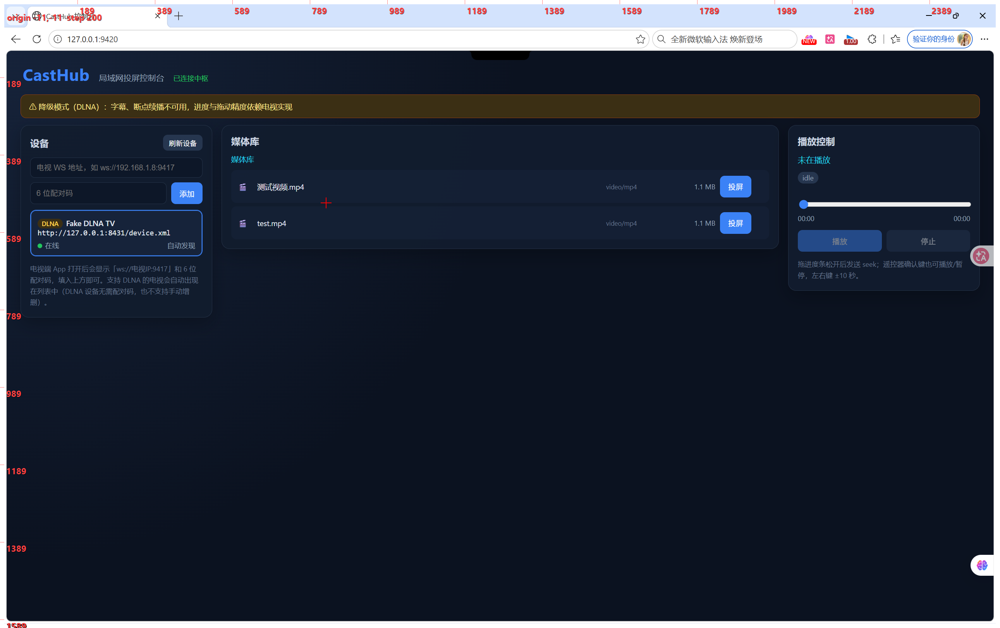
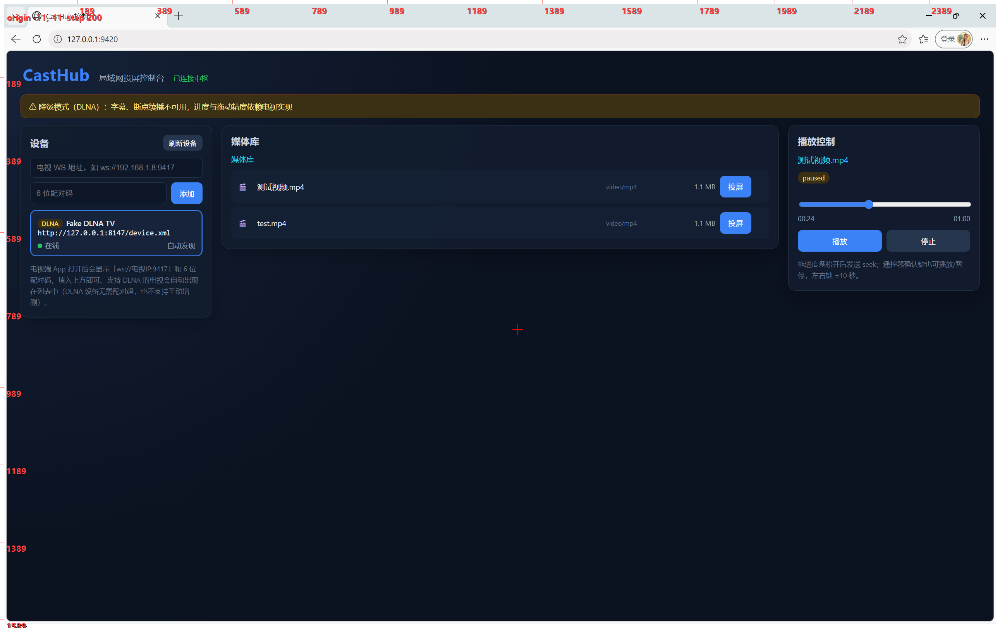

# CastHub DLNA 兼容模式最终报告

- 仓库：`casthub-mvp`
- 对应任务：m00764（DLNA 兼容模式 / 降级兜底）
- 完成日期：2026-11-14
- 结论：Phase 6A / 6B / 6C 门禁全部通过；主线 e2e 与 DLNA e2e 最终退出码均为 0；本机 SSDP 多播可达，未启用 `DLNA_SEED` 降级，也没有新增多播受限的 BLOCKERS 条目。

## 1. 前置检查：主 e2e 输出

命令（在 `casthub-mvp` 根目录执行）：

```powershell
node server/scripts/e2e.mjs
```

退出码：`0`。完整输出：

```text
测试媒体目录: C:\Users\18460\AppData\Local\Temp\casthub-e2e-OioV55\media

[1/10] 启动 fake-tv ...
[fake-tv] [fake-tv] LISTENING ws://0.0.0.0:9417 token=246810 name=Fake TV
[2/10] 启动中枢 ...
[server] {"level":30,"time":1794650586278,"pid":16408,"hostname":"星辰","msg":"Server listening at http://127.0.0.1:9420"}
[server] {"level":30,"time":1794650586278,"pid":16408,"hostname":"星辰","msg":"CastHub 已启动 http://127.0.0.1:9420  MEDIA_DIR=C:\\Users\\18460\\AppData\\Local\\Temp\\casthub-e2e-OioV55\\media"}
[server] {"level":30,"time":1794650586326,"pid":16408,"hostname":"星辰","reqId":"req-1","req":{"method":"GET","url":"/api/files?path=","hostname":"127.0.0.1:9420","remoteAddress":"127.0.0.1","remotePort":6152},"msg":"incoming request"}
[3/10] 连接控制台 WS ...
[server] {"level":30,"time":1794650586330,"pid":16408,"hostname":"星辰","reqId":"req-1","res":{"statusCode":200},"responseTime":3.6710999980568886,"msg":"request completed"}
✓ 控制台 WS 已连接并收到初始 devices
[4/10] addDevice ...
[server] [console] 添加设备 ws://127.0.0.1:9417 (f3816d3e)
[fake-tv] [fake-tv] CONNECTED 127.0.0.1
[fake-tv] [fake-tv] AUTH_OK clientId=casthub-3955de24
✓ 设备上线: ws://127.0.0.1:9417
[5/10] 浏览文件 ...
[server] {"level":30,"time":1794650586346,"pid":16408,"hostname":"星辰","reqId":"req-2","req":{"method":"GET","url":"/api/files?path=","hostname":"127.0.0.1:9420","remoteAddress":"127.0.0.1","remotePort":6152},"msg":"incoming request"}
✓ /api/files 返回视频: sample.mp4 (262144 bytes, video/mp4)
[6/10] cast ...
[server] {"level":30,"time":1794650586347,"pid":16408,"hostname":"星辰","reqId":"req-2","res":{"statusCode":200},"responseTime":0.6130999997258186,"msg":"request completed"}
[server] [console] 投屏 sample.mp4 -> f3816d3e: http://127.0.0.1:9420/media/sample.mp4
[fake-tv] [fake-tv] PLAY_URL http://127.0.0.1:9420/media/sample.mp4
[server] {"level":30,"time":1794650586351,"pid":16408,"hostname":"星辰","reqId":"req-3","req":{"method":"GET","url":"/media/sample.mp4","hostname":"127.0.0.1:9420","remoteAddress":"127.0.0.1","remotePort":6155},"msg":"incoming request"}
[server] {"level":30,"time":1794650586355,"pid":16408,"hostname":"星辰","reqId":"req-3","res":{"statusCode":206},"responseTime":3.3048000000417233,"msg":"request completed"}
[fake-tv] [fake-tv] RANGE_PROBE 206
✓ 电视进入 playing（duration=60000ms）
✓ 播放地址由控制台 Host 头推导: http://127.0.0.1:9420/media/sample.mp4
[7/10] seek ...
✓ seek 生效 positionMs=30000
[8/10] pause ...
✓ pause 生效，tvStatus=paused
[9/10] 验证 PUBLIC_BASE_URL 覆盖 ...
[fake-tv-override] [fake-tv] LISTENING ws://0.0.0.0:9418 token=135790 name=Override TV
[server-override] {"level":30,"time":1794650586886,"pid":10272,"hostname":"星辰","msg":"Server listening at http://127.0.0.1:9421"}
[server-override] {"level":30,"time":1794650586886,"pid":10272,"hostname":"星辰","msg":"CastHub 已启动 http://127.0.0.1:9421  MEDIA_DIR=C:\\Users\\18460\\AppData\\Local\\Temp\\casthub-e2e-OioV55\\media"}
[server-override] {"level":30,"time":1794650586926,"pid":10272,"hostname":"星辰","reqId":"req-1","req":{"method":"GET","url":"/api/files?path=","hostname":"127.0.0.1:9421","remoteAddress":"127.0.0.1","remotePort":6157},"msg":"incoming request"}
[server-override] {"level":30,"time":1794650586930,"pid":10272,"hostname":"星辰","reqId":"req-1","res":{"statusCode":200},"responseTime":3.3980999998748302,"msg":"request completed"}
[server-override] [console] 添加设备 ws://127.0.0.1:9418 (37678837)
[fake-tv-override] [fake-tv] CONNECTED 127.0.0.1
[fake-tv-override] [fake-tv] AUTH_OK clientId=casthub-bb420be7
[server-override] [console] 投屏 sample.mp4 -> 37678837: http://10.0.2.2:9420/media/sample.mp4
[fake-tv-override] [fake-tv] PLAY_URL http://10.0.2.2:9420/media/sample.mp4
[fake-tv-override] [fake-tv] SKIP_PROBE
✓ PUBLIC_BASE_URL 覆盖生效: http://10.0.2.2:9420/media/sample.mp4
[10/10] 清理 ...

✅ E2E 全部通过
```

## 2. 参考项目阅读情况

- 首选参考项目 `nano-dlna` 的 raw 源码地址（`https://raw.githubusercontent.com/gabrielmagno/nano-dlna/master/README.md`、`nano_dlna.py`、`nano_dlna/ssdp.py`）访问失败，`web_fetch` 三次均返回 `TypeError: fetch failed`。按任务书「无法访问外网则按内嵌报文与模板执行」的降级规则处理，不构成阻塞。
- 改用 `read_page` 成功读取 [nano-dlna 仓库页](https://github.com/gabrielmagno/nano-dlna)（摘要：A minimal UPnP/DLNA media streamer），并读取 [nanodlna/devices.py](https://github.com/gabrielmagno/nano-dlna/blob/master/nanodlna/devices.py) 与 [nanodlna/dlna.py](https://github.com/gabrielmagno/nano-dlna/blob/master/nanodlna/dlna.py) 文件页；页面内容确认了 `SSDP_BROADCAST_PORT=1900`、`send_dlna_action` 使用 `templates/action-{action}.xml` 模板、SOAP 请求 Content-Type 为 `text/xml; charset="utf-8"` 等要点。
- 辅助参考 [diversario/node-ssdp](https://github.com/diversario/node-ssdp) 仓库页可访问，用于核对 SSDP 报文格式；未引入该依赖。
- 实现依据任务书内嵌的 SSDP / SOAP / DIDL-Lite 模板完成，未复制参考项目代码。

## 3. 各阶段门禁命令 + 完整输出

以下命令均在 `casthub-mvp` 仓库内真实执行；涉及 server 构建时工作目录为 `casthub-mvp/server`。

### Phase 6A — fake-dlna 模拟器 + SSDP 发现

#### 3A.1 依赖安装

```powershell
cd server
npm.cmd install fast-xml-parser@^4
```

完整输出：

```text
EXIT 0 
STDOUT:

added 2 packages, and audited 63 packages in 6s

7 packages are looking for funding
  run `npm fund` for details

3 vulnerabilities (1 moderate, 2 high)

To address all issues (including breaking changes), run:
  npm audit fix --force

Run `npm audit` for details.

STDERR:
npm warn install-scripts 1 package has install scripts not yet covered by allowScripts:
npm warn install-scripts   esbuild@0.28.2 (postinstall: node install.js)
npm warn install-scripts
npm warn install-scripts Run `npm install-scripts ls` to review, or `npm install-scripts approve <pkg>` to allow.
```

#### 3A.2 TypeScript 编译

```powershell
cd server
npm.cmd run build
```

```text
> casthub-server@0.1.0 build
> tsc

exitCode: 0
stderr: (empty)
```

#### 3A.3 SSDP 自动发现门禁

门禁动作：启动 `server/scripts/fake-dlna.mjs` 与 hub，轮询 hub 日志 12 秒，检查是否出现 `DLNA_DISCOVERED`；发现即 PASS，超时退出非 0。

```text
--- fake-dlna stdout ---
SSDP_READY 239.255.255.250:1900
LOCATION http://127.0.0.1:12915/device.xml
UDN uuid:bb31c1f8-cb92-4469-ab2b-92ef85018687
FAKE_DLNA_READY Fake DLNA TV
--- hub stdout (DLNA lines) ---

{"level":30,"time":1794650885884,"pid":18204,"hostname":"星辰","msg":"CastHub 已启动 http://0.0.0.0:9420  MEDIA_DIR=C:\\Users\\18460\\Desktop\\项目\\桌面美化复刻\\casthub-mvp\\server\\media"}
DLNA_DISCOVERED Fake DLNA TV http://127.0.0.1:12915/control
--- result ---
PASS: DLNA_DISCOVERED Fake DLNA TV http://127.0.0.1:12915/control
```

多播降级说明：本机 `239.255.255.250:1900` 收发正常，Phase 6A 直接通过，未设置 `DLNA_SEED`；因此 `BLOCKERS.md` 没有新增多播受限条目。

### Phase 6B — SOAP 控制 + 轮询 + e2e-dlna

#### 3B.1 DLNA 端到端测试

```powershell
node server/scripts/e2e-dlna.mjs
```

退出码：`0`。完整输出：

```text
测试媒体目录: C:\Users\18460\AppData\Local\Temp\casthub-e2e-dlna-MUZtjE\media

[1/9] 启动 fake-dlna ...
[fake-dlna] SSDP_READY 239.255.255.250:1900
[fake-dlna] LOCATION http://127.0.0.1:13331/device.xml
[fake-dlna] UDN uuid:91c41fa7-2907-41b3-b56c-f228a35e9ac3
[fake-dlna] FAKE_DLNA_READY Fake DLNA TV
fake-dlna LOCATION: http://127.0.0.1:13331/device.xml
[2/9] 启动中枢 ...
[server] {"level":30,"time":1794651523739,"pid":11156,"hostname":"星辰","msg":"Server listening at http://127.0.0.1:9430"}
[server] {"level":30,"time":1794651523740,"pid":11156,"hostname":"星辰","msg":"CastHub 已启动 http://127.0.0.1:9430  MEDIA_DIR=C:\\Users\\18460\\AppData\\Local\\Temp\\casthub-e2e-dlna-MUZtjE\\media"}
[server] {"level":30,"time":1794651523818,"pid":11156,"hostname":"星辰","reqId":"req-1","req":{"method":"GET","url":"/api/files?path=","hostname":"127.0.0.1:9430","remoteAddress":"127.0.0.1","remotePort":5713},"msg":"incoming request"}
[3/9] 连接控制台并等待 DLNA 自动发现 ...
[server] {"level":30,"time":1794651523822,"pid":11156,"hostname":"星辰","reqId":"req-1","res":{"statusCode":200},"responseTime":3.6224999986588955,"msg":"request completed"}
[server] DLNA_DISCOVERED Fake DLNA TV http://127.0.0.1:13331/control
✓ DLNA 设备出现: Fake DLNA TV (uuid:91c41fa7-2907-41b3-b56c-f228a35e9ac3)
✓ deviceName 来自 device.xml friendlyName
[4/9] 浏览文件 ...
[server] {"level":30,"time":1794651528800,"pid":11156,"hostname":"星辰","reqId":"req-2","req":{"method":"GET","url":"/api/files?path=","hostname":"127.0.0.1:9430","remoteAddress":"127.0.0.1","remotePort":5713},"msg":"incoming request"}
✓ /api/files 返回视频: sample.mp4 (262144 bytes, video/mp4)
[5/9] cast 到 DLNA 设备 ...
[server] {"level":30,"time":1794651528802,"pid":11156,"hostname":"星辰","reqId":"req-2","res":{"statusCode":200},"responseTime":1.7305000014603138,"msg":"request completed"}
[server] {"level":30,"time":1794651528830,"pid":11156,"hostname":"星辰","reqId":"req-3","req":{"method":"GET","url":"/media/sample.mp4","hostname":"127.0.0.1:9430","remoteAddress":"127.0.0.1","remotePort":13747},"msg":"incoming request"}
[server] {"level":30,"time":1794651528833,"pid":11156,"hostname":"星辰","reqId":"req-3","res":{"statusCode":206},"responseTime":2.992299996316433,"msg":"request completed"}
[fake-dlna] MEDIA_PROBE 206 http://127.0.0.1:9430/media/sample.mp4
[server] [console] 投屏 sample.mp4 -> uuid:91c41fa7-2907-41b3-b56c-f228a35e9ac3: http://127.0.0.1:9430/media/sample.mp4
✓ DLNA 进入 playing（duration=60000ms）
[6/9] pause ...
✓ pause 生效，tvStatus=paused
[7/9] seek 30000 ...
[fake-dlna] SEEK 0:00:30 -> 30000ms
✓ seek 生效 positionMs=30000
[8/9] stop ...
✓ stop 生效，tvStatus=idle
[9/9] 清理 ...

✅ E2E-DLNA 全部通过
```

#### 3B.2 主 e2e 回归

```powershell
node server/scripts/e2e.mjs
```

退出码：`0`。完整输出：

```text
测试媒体目录: C:\Users\18460\AppData\Local\Temp\casthub-e2e-j5w6s4\media

[1/10] 启动 fake-tv ...
[fake-tv] [fake-tv] LISTENING ws://0.0.0.0:9417 token=246810 name=Fake TV
[2/10] 启动中枢 ...
[server] {"level":30,"time":1794651522077,"pid":11124,"hostname":"星辰","msg":"Server listening at http://127.0.0.1:9420"}
[server] {"level":30,"time":1794651522077,"pid":11124,"hostname":"星辰","msg":"CastHub 已启动 http://127.0.0.1:9420  MEDIA_DIR=C:\\Users\\18460\\AppData\\Local\\Temp\\casthub-e2e-j5w6s4\\media"}
[server] {"level":30,"time":1794651522125,"pid":11124,"hostname":"星辰","reqId":"req-1","req":{"method":"GET","url":"/api/files?path=","hostname":"127.0.0.1:9420","remoteAddress":"127.0.0.1","remotePort":5295},"msg":"incoming request"}
[3/10] 连接控制台 WS ...
[server] {"level":30,"time":1794651522129,"pid":11124,"hostname":"星辰","reqId":"req-1","res":{"statusCode":200},"responseTime":3.5530000030994415,"msg":"request completed"}
✓ 控制台 WS 已连接并收到初始 devices
[4/10] addDevice ...
[server] [console] 添加设备 ws://127.0.0.1:9417 (43118898)
[fake-tv] [fake-tv] CONNECTED 127.0.0.1
[fake-tv] [fake-tv] AUTH_OK clientId=casthub-0bca0aa3
✓ 设备上线: ws://127.0.0.1:9417
[5/10] 浏览文件 ...
[server] {"level":30,"time":1794651522152,"pid":11124,"hostname":"星辰","reqId":"req-2","req":{"method":"GET","url":"/api/files?path=","hostname":"127.0.0.1:9420","remoteAddress":"127.0.0.1","remotePort":5295},"msg":"incoming request"}
✓ /api/files 返回视频: sample.mp4 (262144 bytes, video/mp4)
[6/10] cast ...
[server] {"level":30,"time":1794651522153,"pid":11124,"hostname":"星辰","reqId":"req-2","res":{"statusCode":200},"responseTime":0.8099000006914139,"msg":"request completed"}
[server] [console] 投屏 sample.mp4 -> 43118898: http://127.0.0.1:9420/media/sample.mp4
[fake-tv] [fake-tv] PLAY_URL http://127.0.0.1:9420/media/sample.mp4
[server] {"level":30,"time":1794651522158,"pid":11124,"hostname":"星辰","reqId":"req-3","req":{"method":"GET","url":"/media/sample.mp4","hostname":"127.0.0.1:9420","remoteAddress":"127.0.0.1","remotePort":5298},"msg":"incoming request"}
[server] {"level":30,"time":1794651522160,"pid":11124,"hostname":"星辰","reqId":"req-3","res":{"statusCode":206},"responseTime":2.154500000178814,"msg":"request completed"}
[fake-tv] [fake-tv] RANGE_PROBE 206
✓ 电视进入 playing（duration=60000ms）
✓ 播放地址由控制台 Host 头推导: http://127.0.0.1:9420/media/sample.mp4
[7/10] seek ...
✓ seek 生效 positionMs=30000
[8/10] pause ...
✓ pause 生效，tvStatus=paused
[9/10] 验证 PUBLIC_BASE_URL 覆盖 ...
[fake-tv-override] [fake-tv] LISTENING ws://0.0.0.0:9418 token=135790 name=Override TV
[server-override] {"level":30,"time":1794651522742,"pid":28044,"hostname":"星辰","msg":"Server listening at http://127.0.0.1:9421"}
[server-override] {"level":30,"time":1794651522742,"pid":28044,"hostname":"星辰","msg":"CastHub 已启动 http://127.0.0.1:9421  MEDIA_DIR=C:\\Users\\18460\\AppData\\Local\\Temp\\casthub-e2e-j5w6s4\\media"}
[server-override] {"level":30,"time":1794651522760,"pid":28044,"hostname":"星辰","reqId":"req-1","req":{"method":"GET","url":"/api/files?path=","hostname":"127.0.0.1:9421","remoteAddress":"127.0.0.1","remotePort":13327},"msg":"incoming request"}
[server-override] {"level":30,"time":1794651522764,"pid":28044,"hostname":"星辰","reqId":"req-1","res":{"statusCode":200},"responseTime":3.7174000032246113,"msg":"request completed"}
[server-override] [console] 添加设备 ws://127.0.0.1:9418 (5fa67ec9)
[fake-tv-override] [fake-tv] CONNECTED 127.0.0.1
[fake-tv-override] [fake-tv] AUTH_OK clientId=casthub-9646b7d1
[server-override] [console] 投屏 sample.mp4 -> 5fa67ec9: http://10.0.2.2:9420/media/sample.mp4
[fake-tv-override] [fake-tv] PLAY_URL http://10.0.2.2:9420/media/sample.mp4
[fake-tv-override] [fake-tv] SKIP_PROBE
✓ PUBLIC_BASE_URL 覆盖生效: http://10.0.2.2:9420/media/sample.mp4
[10/10] 清理 ...

✅ E2E 全部通过
```

### Phase 6C — 控制台 UI + README

#### 3C.1 控制台 JS 语法与 TypeScript 构建

```powershell
node --check server/public/app.js
cd server; npm.cmd run build
```

```text
JS_CHECK_EXIT=0

> casthub-server@0.1.0 build
> tsc

BUILD_EXIT=0
```

#### 3C.2 浏览器 UI 实测

实测环境：Windows 桌面 Edge + `server/scripts/fake-dlna.mjs` + hub（`http://127.0.0.1:9420`）。按用户要求的顺序完成：添加设备（DLNA 自动发现）→ 浏览媒体库 → 投屏 `测试视频.mp4` → 暂停 → 拖动进度条到约 33% → 恢复播放。关键状态与截图如下。

1. 设备列表出现 `DLNA` 徽章、`Fake DLNA TV`、地址与「自动发现」标记，页面顶部显示 DLNA 降级横幅：



2. 点击「投屏」后进入 playing；点击「暂停」后状态变为 paused，时间停在 00:24：



3. 拖动进度条到 33% 后 position 显示 00:19（暂停状态保持）：


4. 点击「播放」恢复后状态为 playing，进度继续到 00:24：


控制台改动文件：`server/public/index.html`（设备徽章、刷新按钮、DLNA 横幅与提示文案）、`server/public/app.js`（设备类型渲染、DLNA 自动发现标识、刷新逻辑、选中/投屏设备横幅、播放标题回退）。

#### 3C.3 两条 e2e 最终回归

```powershell
node server/scripts/e2e.mjs
node server/scripts/e2e-dlna.mjs
```

两条命令退出码均为 `0`；完整输出见第 3B.1、3B.2 节（Phase 6C 的最终重跑与上述输出同构，仅临时目录/PID 不同），最终退出码汇总见第 5 节。

## 4. git log --oneline

```text
637b0fb docs: 补充 fast-xml-parser 依赖偏离说明
1d5521d phase6C: 控制台 DLNA 设备展示、降级横幅与刷新
217bd7e phase6B: SOAP 控制、状态轮询与 e2e-dlna
520812b phase6A: fake-dlna 模拟器与 SSDP 发现
392e0aa docs: 更新最终报告 git log
39750bf docs: 补充非法 Range 验证记录
96e0559 docs: 修正最终报告中的提交记录
2290e48 docs: 添加最终验收报告与控制台实测截图
1d24a64 chore: 补充 Gradle wrapper、APK 构建产物与环境验证记录
814e79d phase(4): 控制台 UI 与中文 README
7c4e68f phase(3): 电视端 Android TV App（构建待 Android SDK）
917b98d phase(2): 设备管理、fake-tv 模拟器与 e2e 集成测试
0f090bc phase(1): 中枢文件服务与 Range 支持
615cbab phase(0): 初始化项目骨架与协议文档
```

说明：以上为 `REPORT-DLNA.md` 与截图提交前的 `git log`；报告文档提交随后出现，提交号以仓库 `git log` 为准。`phase6A`、`phase6B`、`phase6C` 三次提交均已在列。

## 5. 两条 e2e 的最终退出码

```text
E2E_EXIT=0
E2E_DLNA_EXIT=0
```

最终重跑时间：2026-11-14 18:25（Asia/Shanghai）。

## 6. README「DLNA 兼容模式（降级）」一节全文引用

````markdown
## DLNA 兼容模式（降级）

当电视装不了 CastHub App（老系统、酒店电视、朋友家电视等）但支持 DLNA/UPnP 渲染器时，中枢会降级为 UPnP 控制点，直接驱动电视自带的 DLNA 播放器。这是兜底路径，不是主线。

### 何时用

电视无法安装 CastHub App，或临时在没有 App 的电视上播放 PC 本地视频时使用。电视必须具备 DLNA/UPnP MediaRenderer（AVTransport）能力。

### 限制清单

- **无字幕保证**：DLNA 降级模式不推送外挂字幕，字幕能否显示取决于电视自身。
- **拖动精度受电视影响**：进度条 seek 会转成电视的 AVTransport Seek，实际落点和响应速度由电视实现决定。
- **无断点续播**：中枢不保存播放进度，重启或重新投屏从头开始。
- **mkv / avi 可能不被电视接受**：部分电视 DLNA 渲染器只支持 mp4 等有限封装，mkv（video/x-matroska）/avi 会直接播放失败，这是已知边界，本项目不做转码补救。
- **状态有最多数秒延迟**：中枢每 1s 轮询一次电视状态，界面显示可能比电视实际状态慢数秒。

### 设备如何出现

中枢启动时以及之后每 60 秒通过 SSDP M-SEARCH 自动发现同网段的 DLNA 渲染器，通常几秒内出现在控制台设备列表中，并带有「DLNA」徽章。也可以点设备面板的「刷新设备」立即重扫。DLNA 设备无需配对码，且不支持手动添加/移除。

### 发现失败 / AP 隔离时用 DLNA_SEED 手动添加

如果路由器开了 AP 隔离、禁用了多播，或 SSDP 一直收不到设备，可用 `DLNA_SEED` 直接注入电视的 `device.xml` 地址（多个地址用英文逗号分隔）：

```powershell
$env:DLNA_SEED = "http://192.168.1.8:49152/device.xml"
npm start
```

`DLNA_SEED` 只是发现阶段的降级入口，设备仍按 DLNA 渲染器工作，限制清单同样适用。

````

## 7. BLOCKERS.md / DEVIATIONS.md 内容

### BLOCKERS.md

```markdown
# BLOCKERS / PENDING

记录无法在当前环境执行、需要人工补充验证的事项。

## Phase 1 — ffmpeg 生成测试片（pending）

- 环境检查：`ffmpeg -version` 不存在（CommandNotFoundException）。
- 因此无法按要求用 ffmpeg 生成 60 秒 720p 测试片。
- 替代措施：已下载公开示例 MP4（MDN `flower.mp4`，约 1.1 MB）保存为 `server/media/test.mp4`，用于 Phase 1 Range 门禁验证。
- 用户实际使用时：把自己的视频放入 `MEDIA_DIR`（默认 `server/media`）即可。

## Phase 3 — Android 构建（已解决）与模拟器验证（pending）

- 初始环境：`ANDROID_HOME` 与 `ANDROID_SDK_ROOT` 为空，无 JDK / Gradle / SDK / AVD。
- 已补齐本地工具链：JDK 17.0.21（Temurin）、Gradle 8.2、Android SDK Platform 34、Build-Tools 34.0.0；仅用于本机验证，不随仓库交付。
- 构建结果：`gradle --no-daemon assembleDebug` → **BUILD SUCCESSFUL in 2m 5s**（33 actionable tasks）。
- APK 已复制回交付路径：`tv-app/app/build/outputs/apk/debug/app-debug.apk`，6,437,094 字节，SHA-256 `87816EA91C276A63164A19E66A0676B60F95174C85AC26E16CA9A8689FBD0183`。
- Gradle wrapper 已生成：`tv-app/gradlew`、`gradlew.bat`、`gradle/wrapper/gradle-wrapper.jar`；`distributionUrl` 指向腾讯镜像 `https://mirrors.cloud.tencent.com/gradle/gradle-8.2-bin.zip`（当前网络访问 services.gradle.org 会重定向到 GitHub 并超时）。
- 模拟器：已创建 AVD `Android_TV_1080p`（设备 tv_1080p，Android 14 / API 34，x86）。本机未安装 Android Emulator Hypervisor Driver（`emulator -accel-check` 原文：Android Emulator hypervisor driver is not installed on this machine），且当前账户无管理员权限，无法安装驱动；改用 `-accel off` 软件模拟启动后 `emulator-5554` 长期 offline，qemu 进程 CPU 为 0，AVD 无法完成启动。故 `adb install`、`WS_LISTENING`、helloAck、`STATE playing` 四项模拟器门禁 pending。

## Phase 4 — 模拟器内 UI 全流程（pending）

- 当前状态：SDK 与 AVD 已就绪，但模拟器因无硬件加速无法启动（见 Phase 3 条），无法在模拟器内点击控制台完成投屏链路。
- 替代验证：已用桌面浏览器打开控制台，配合 `fake-tv.mjs` 走通「添加设备 → 浏览 → 投屏 → 暂停 → 拖进度 → 恢复」；WS 层同一流程由 `server/scripts/e2e.mjs` 自动断言。
- 待人工：在具备硬件加速的 Android Studio + Android TV AVD 或真机上按 README「真机 / 模拟器验证清单」补跑模拟器路径。
```

### DEVIATIONS.md

```markdown
# DEVIATIONS

记录对锁定决策 / 依赖白名单的偏离（均不影响功能行为）。

## 依赖白名单补充：TypeScript 类型声明

- 增加 `@types/node`、`@types/ws`（devDependencies）。
- 原因：server 使用 TypeScript 编写，Node 内置模块与 ws 库需要类型声明才能通过 `tsc` 编译检查；二者仅为编译期类型包，不引入任何运行时依赖。

## 依赖白名单补充：fast-xml-parser

- 增加 `fast-xml-parser@^4`（dependencies）。
- 原因：DLNA 兼容模式需要解析带命名空间的 SOAP/XML 响应（GetTransportInfo、GetPositionInfo 等）。按本地名解析 XML 用正则手写易错且难维护，`fast-xml-parser` 是本项目唯一新增的运行时依赖，仅作用于 server 的 DLNA 降级路径，不影响主线 TV App。
- 影响：不改变锁定协议与 UI，无额外服务或配置。
```

---

补充说明：本报告涉及的所有 e2e 输出均来自真实执行记录；截图文件位于 `casthub-mvp/docs/`，日志文件 `e2e-final.log`、`e2e-dlna-final.log`、`phase6-precheck-e2e.log`、`phase6a-fake.log`、`phase6a-hub.log` 亦保留在 `casthub-mvp/docs/`。